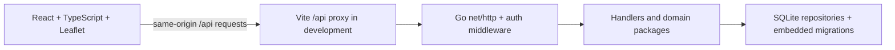

# GeoEntity

GeoEntity is a map-based system for managing geographic entities and their operational history. It combines a React and TypeScript web interface, a Go HTTP API, Leaflet maps, and SQLite persistence.

**Current project status:** the V2.1–V2.7 milestones and V2.8A automated integration QA are recorded as complete. V2.8C UI work exists in the current working tree; automated frontend checks pass, while browser visual verification is not currently evidenced. This is a local development project, not a deployed production service.

## Capabilities

| Area | Implemented behavior | Limits and verification notes |
|---|---|---|
| Entities | Create, read, update, delete, search, filter, page, map, and inspect entities. | The legacy list endpoint remains for compatibility; the UI uses query/map routes. |
| Map | Leaflet markers and clustering, entity selection, map-based coordinate selection, Fit All, Locate Me, legend, and coordinate inspector. | Tile availability depends on the selected provider and network. Location picker layout changes in this worktree have automated build/test evidence but no new browser screenshots. |
| Entity metadata | Per-type custom attribute definitions/values, tags, categories, and append-only activity history. | Validation and size limits are enforced by the backend. |
| Data exchange | CSV and GeoJSON export; preview and commit flows for supported imports. | Import requests are bounded and preview-token/fingerprint checks are required at commit. |
| Geofences | Circle and simple Polygon definitions, current entity membership, transition history, map overlays, and event queries. | Circle containment uses haversine distance. Polygon containment uses spherical ring winding, while ring validation uses planar longitude/latitude checks and rejects spans of 180° or more. One exterior ring only; no holes or MultiPolygon. |
| Authentication | One CLI-provisioned administrator, passphrase login, opaque server-side sessions, logout/revocation, CSRF and Origin checks. | No registration or password reset. Cookies are Secure by default; local HTTP development needs the explicit loopback-only setting below. |
| IoT monitoring | CLI-managed device credentials, authenticated single-observation ingestion, idempotency, latest readings, paginated history, and a monitoring view. | No automatic telemetry retention; history grows. Rate-limit state is process-local. |
| Security and operations | Request validation and limits, audit records, backup/restore CLI, default-deny protected API middleware, and single-process database lock. | Production hosting, TLS proxy, external recovery, capacity, and multi-host behavior are not supplied or claimed. |

## Architecture



In production, Vite is not the API gateway: a separately configured TLS-terminating reverse proxy must serve the frontend and route `/api/*` on the same HTTPS origin. No production proxy or deployment configuration is included. The auth middleware validates the administrator session and applies CSRF plus exact-origin checks to unsafe browser requests. The exact device observation-ingest route uses its own bearer credential. Handlers call domain services/repositories; repositories own SQL access and migrations.

## Prerequisites

- Go **1.27.3 or newer**, as declared in `backend/go.mod`.
- Node.js **18, 20, or 22+** as allowed by the locked Vite package; use an npm version compatible with that Node release. The repository does not pin an npm version.
- A browser for interactive use. Map tiles and external fonts require network access unless separately configured.
- SQLite is embedded through `modernc.org/sqlite`; a system SQLite executable is not required for normal application use.

## Local setup

Run backend and frontend in separate terminals. Commands below use a local HTTP frontend and an isolated development database path. Choose a different database filename if that path already contains data. Do not point development or tests at valuable or protected databases.

### 1. Install dependencies

```sh
cd backend
go mod download

cd ../frontend
npm ci
```

No `frontend/.env.example` is present. Vite settings may be supplied through the shell environment or a local, untracked `.env` file. Never put secrets in `VITE_` variables; they become browser-visible build values.

### 2. Provision the administrator

From `backend/`, set the same database and browser origin that the API will use. The CLI prompts twice without echoing the passphrase; it does not accept the passphrase as an argument.

```sh
cd backend
GEOENTITY_DB_PATH=./data/geoentity-dev.db \
GEOENTITY_PUBLIC_ORIGIN=http://localhost:5173 \
GEOENTITY_DEV_COOKIE_INSECURE=true \
go run ./cmd/geoentity admin provision
```

Use a unique passphrase of at least 15 Unicode code points; common or known-compromised values are rejected. Do not commit or log it. Provisioning opens the selected database and applies pending embedded migrations. The API refuses to start until an administrator exists.

### 3. Start the API

In a second terminal:

```sh
cd backend
GEOENTITY_ADDR=127.0.0.1:8080 \
GEOENTITY_DB_PATH=./data/geoentity-dev.db \
GEOENTITY_PUBLIC_ORIGIN=http://localhost:5173 \
GEOENTITY_DEV_COOKIE_INSECURE=true \
go run ./cmd/api
```

### 4. Start the frontend

In a third terminal:

```sh
cd frontend
npm run dev
```

Open `http://localhost:5173`. Vite serves port 5173 and proxies `/api` to `http://localhost:8080` by default. Sign in with the passphrase provisioned above. The HTTP cookie override is accepted only when the API bind address is loopback. Do not use it outside local development.

### Authentication flow

`GET /api/auth/session` checks the session and returns CSRF bootstrap data. `POST /api/auth/login` authenticates the administrator and sets an HttpOnly session cookie. The frontend holds the returned CSRF token in memory. Protected reads require the cookie; unsafe browser requests also require the expected Origin and `X-CSRF-Token`. `POST /api/auth/logout` revokes the server-side session and clears the cookie. No passphrase is stored in browser storage.

## Configuration

The Go process reads environment variables directly; it does not load dotenv files. Defaults below are from the API/CLI and frontend source. Optional browser variables are compiled into the frontend and must not contain secrets.

| Variable | Purpose | Required | Default |
|---|---|---:|---|
| `GEOENTITY_ADDR` | Go HTTP listen address. | No | `127.0.0.1:8080` |
| `GEOENTITY_DB_PATH` | SQLite file path, relative to the backend process working directory. | No | `./data/geoentity.db` |
| `GEOENTITY_PUBLIC_ORIGIN` | Exact browser-facing origin used by auth and CSRF checks. | No | `https://localhost:5173` |
| `GEOENTITY_DEV_COOKIE_INSECURE` | Disable Secure cookie for loopback-only HTTP development. | No | unset/false; Secure enabled |
| `GEOENTITY_TRUSTED_PROXY_CIDRS` | Comma-separated trusted proxy CIDRs for forwarded client-IP handling. Required for non-loopback bind. | Conditional | empty |
| `GEOENTITY_BACKUP_DIR` | CLI backup directory. | No | `./backups` |
| `GEOENTITY_BACKUP_KEEP` | Number of backups retained by backup creation. | No | `10` |
| `VITE_API_BASE_URL` | Frontend API prefix. | No | `/api` |
| `VITE_PROXY_TARGET` | Vite development proxy target for `/api`. | No | `http://localhost:8080` |
| `VITE_MAP_TILE_URL` | Leaflet tile URL template. | No | `https://tile.openstreetmap.org/{z}/{x}/{y}.png` |
| `VITE_MAP_ATTRIBUTION` | Attribution markup displayed for map tiles. | No | OpenStreetMap contributor attribution |
| `VITE_MAP_MAX_ZOOM` | Positive integer maximum tile zoom. Invalid or empty values fall back. | No | `19` |

For production, keep Secure cookies enabled, set an HTTPS `GEOENTITY_PUBLIC_ORIGIN`, and place the service behind a TLS-terminating proxy. Non-loopback binding is rejected without trusted proxy CIDRs. Configure proxy trust narrowly; forwarded IP headers from untrusted peers are ignored.

## Database and migrations

The repository embeds numbered SQL files in `backend/internal/repository/migrations/` and applies pending migrations when `repository.Open` starts. The migration ledger records checksums. The current schema history is migrations 001–007. Keep the database path stable and use persistent storage for a deployment. The supported service model is one API process per SQLite database; SQLite serializes writers.

Use temporary database paths for tests and local experiments. The CLI supports verified backups and restore:

```sh
cd backend
go run ./cmd/geoentity admin backup create
go run ./cmd/geoentity admin backup list
go run ./cmd/geoentity admin backup verify <manifest.json>
go run ./cmd/geoentity admin restore --from <manifest.json>
```

Restore is an operator action: stop the API first, verify the intended manifest and target, then restore. These commands can modify database or backup files; do not run them against protected or valuable data as a test.

## Device administration

Device lifecycle operations are CLI-based. Supported command families are `device provision <entity-id> <label> [expected-interval-seconds>`, `device list`, `device rotate <device-id>`, `device revoke <device-id>`, `device detach <device-id>`, and `device reassociate <device-id> <entity-id>`. Run `go run ./cmd/geoentity device` from `backend/` to see usage. A generated raw device credential is displayed only when provisioned, rotated, or reassociated; store it securely because it cannot be recovered. Ingestion uses `POST /api/device/v1/observations` with bearer authorization and an idempotency key.

## API reference

All routes use `/api`. Except health, auth bootstrap/login, and device ingestion, routes require the administrator session. Browser-originated unsafe methods require the exact configured Origin and CSRF token header. API errors use JSON envelopes where returned by handlers; auth middleware may return plain HTTP errors. Request bodies are JSON except CSV/GeoJSON import bodies and export downloads.

| Method | Path | Access | Purpose and notes |
|---|---|---|---|
| GET | `/health` | Public | Health status. |
| GET | `/auth/session` | Public bootstrap | Session state and CSRF token. |
| POST | `/auth/login` | Public, rate-limited | Administrator passphrase; successful response sets HttpOnly cookie. |
| POST | `/auth/logout` | Admin + CSRF | Revoke current session and clear cookie. |
| GET, POST | `/entities` | Admin; POST needs CSRF | Legacy list and create. Create validates entity fields. |
| GET, PUT, DELETE | `/entities/{id}` | Admin; writes need CSRF | Read, update, and delete entity. |
| GET | `/entities/query` | Admin | Search/filter/keyset page; bounded limit and validated cursor/filters. |
| GET | `/entities/map` | Admin | Viewport-bounded entity markers with supported filters. |
| GET | `/entities/map/extent` | Admin | Filtered map bounds. |
| GET, POST | `/attribute-definitions` | Admin; POST needs CSRF | List by `entity_type`; create a validated definition. |
| PUT | `/attribute-definitions/{id}` | Admin + CSRF | Update/archive a definition. |
| GET, PUT | `/entities/{id}/attributes` | Admin; PUT needs CSRF | Read or replace attribute values. |
| GET, POST, DELETE | `/tags`, `/tags/{id}` | Admin; writes need CSRF | Manage tag catalog. |
| GET, POST, DELETE | `/categories`, `/categories/{id}` | Admin; writes need CSRF | Manage category catalog. |
| GET, PUT | `/entities/{id}/tags` | Admin; PUT needs CSRF | Read or replace entity tag assignments. |
| GET, PUT | `/entities/{id}/categories` | Admin; PUT needs CSRF | Read or replace entity category assignments. |
| GET | `/entities/{id}/activity` | Admin | Paginated append-only activity history. |
| GET, POST | `/geofences` | Admin; POST needs CSRF | List/filter definitions or create a circle/polygon definition. |
| GET, PUT, DELETE | `/geofences/{id}` | Admin; writes need CSRF | Read, update, or delete a definition. |
| GET | `/entities/{id}/geofences` | Admin | Current membership/containment state. |
| GET | `/geofences/{id}/events` | Admin | Filtered, paginated transition history. |
| GET | `/exports/entities.csv`, `/exports/entities.geojson` | Admin | Download filtered entity data. |
| POST | `/imports/csv/preview`, `/imports/geojson/preview` | Admin + CSRF | Validate and preview an import without committing it. |
| POST | `/imports/csv/commit`, `/imports/geojson/commit` | Admin + CSRF | Commit a matching preview using the preview fingerprint header. |
| GET | `/admin/audit` | Admin | Paginated administrator audit history. |
| GET | `/admin/devices` | Admin | Paginated device registry; raw credentials are never returned. |
| POST | `/device/v1/observations` | Device bearer credential | Ingest one observation; requires `Idempotency-Key`, bounded JSON, and validated device/sensor data. |
| GET | `/monitoring/latest` | Admin | Latest readings; requires `entity_id`. |
| GET | `/entities/{id}/sensors/observations` | Admin | Bounded, filterable, cursor-paginated sensor history. |

Common request/response details verified in source:

- Entity create/update JSON fields: `name`, `type`, `description`, `status`, `latitude`, and `longitude`. Types are `vehicle`, `iot_device`, `facility`, `other`; statuses are `active`, `inactive`, `maintenance`; coordinates must be finite and within latitude −90…90 and longitude −180…180. Successful create returns 201 with `{ "data": entity }`; reads/updates return 200; successful deletes return 204.
- Geofence create/update JSON fields: `name`, optional `enabled`, and `geometry`. Circle geometry is `{ "type": "Circle", "center": [longitude, latitude], "radius_m": number }`; Polygon geometry is `{ "type": "Polygon", "coordinates": [[[longitude, latitude], ...closed ring...]] }`. Create returns 201; read/update return 200; delete returns 204. Invalid geometry/query parameters return 400; duplicate normalized names return 409.
- Telemetry ingestion JSON fields are `sensor_id`, `value`, `unit`, `observed_at`, and optional `metadata`. It requires exactly one `Authorization: Bearer …` and `Idempotency-Key` header. Success creates an observation response; invalid payload is 400, unauthorized device is 401, conflicts are 409, oversized body is 413, and limiter rejection is 429.
- CSV/GeoJSON import preview returns validation, warning, duplicate, and fingerprint data. Commit requires the matching `X-Preview-SHA256`; stale preview or write conflicts are rejected. Import bodies are limited to 5 MiB and 5,000 rows/features; export is limited to 100,000 entities.
- Handler validation errors generally use `{ "error": { "code", "message", "field?" } }`. Auth middleware errors are plain HTTP text. Across route families, expected failure statuses include 400 (input/query), 401 (authentication), 403 (Origin/CSRF), 404 (missing route/resource), 405 (method), 409 (conflict), 413 (size/result bound), 429 (rate limit), and 500 (internal failure); individual endpoints use only the applicable subset.

Refer to `backend/internal/handler/` and `backend/internal/auth/auth.go` for exhaustive DTO fields, query parameters, exact limits, error codes, and per-route status behavior. The API table is an endpoint index, not a substitute for source-level DTO definitions. Do not call protected routes with unauthenticated examples or expose device credentials in documentation.

## Development and verification

From `backend/`:

```sh
go test ./...
go test -race -count=1 ./...
go vet ./...
go build ./...
```

From `frontend/`:

```sh
npm test
npm run build
```

The frontend test command runs Vitest; the build runs TypeScript project checks and Vite production bundling. Go tests use isolated temporary or in-memory databases in their fixtures. A green automated suite does not constitute real-browser visual QA. Browser screenshots and interaction claims must identify actual browser evidence; the repository does not include a configured browser E2E runner.

## Security and known limitations

- One administrator is provisioned through the CLI; there is no public registration/password reset.
- Browser sessions are opaque, server-side, hashed at rest, and expire after idle/absolute time limits. Mutation requests require CSRF and exact Origin checks.
- Device ingestion has an independent credential and idempotency key. Admin cookies do not authorize device ingestion.
- SQLite is single-writer and the application permits one API process per database. Login, mutation, and device limiters are process-local and do not coordinate across hosts.
- Telemetry and geofence transition history are append-only without automatic retention/pruning. Storage and backup size grows over time.
- Circle containment uses haversine distance with a maximum radius of 10,000,000 m. Polygon containment uses spherical ring winding; polygon validity checks such as signed area and self-intersection are planar over longitude/latitude coordinates. Rings are limited to 256 vertices and a longitude span below 180°. Holes, MultiPolygon, self-intersections, and antimeridian-crossing polygons are rejected or unsupported.
- Deployment, HTTPS termination, proxy hardening, monitoring, and off-host recovery are operator responsibilities and have not been production-verified here.
- OpenStreetMap's standard tile server is a best-effort public service without an SLA; preserve attribution and comply with its usage policy. Select another provider for higher-volume production.
- The last V2.8C frontend automated run in this worktree passed 199 tests and a production build; the build emitted the existing >500 kB chunk warning. No new browser screenshots were captured for the latest map banner changes.

## Project structure

| Path | Responsibility |
|---|---|
| `backend/cmd/api/` | HTTP API process startup and runtime configuration. |
| `backend/cmd/geoentity/` | Administrator/device provisioning, backup, and restore CLI. |
| `backend/internal/auth/` | Administrator authentication, session/CSRF middleware, and audit helpers. |
| `backend/internal/handler/` | API routing, request validation, response envelopes, and endpoint behavior. |
| `backend/internal/` | Entity, geofence, monitoring, backup, maintenance, and domain packages. |
| `backend/internal/repository/` | SQLite repositories and embedded numbered migrations. |
| `frontend/src/api/` | Typed HTTP client and API operations. |
| `frontend/src/components/` | UI, map, entity, geofence, monitoring, and authentication components. |
| `frontend/src/utils/` | Validation, formatting, navigation, and reusable frontend logic. |

## Agent-assisted development

`AGENT.md` defines repository boundaries, implementation conventions, safety rules, verification standards, and authorization gates for coding agents. Agents must preserve existing work, read the current Git state before editing, and report unverified behavior honestly. Human authorization remains required for scope expansion and Git publication actions.

## License and contributions

No repository-level license or contribution policy is established in the inspected root documentation. Do not infer one from third-party dependency licenses.
